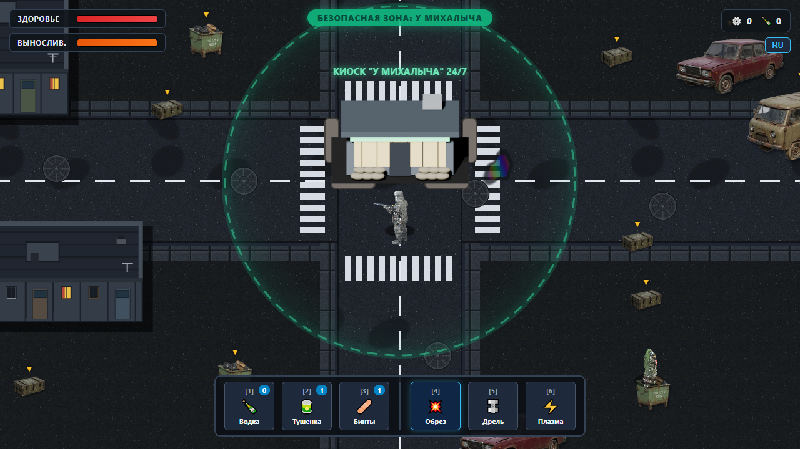

# Василий против пришельцев: Новохмуринский Квакокалипсис 🐸💥

> **Постсоветский дизельпанк top-down / 2.5D экшен-рогалик.**  
> В роли Василия — бомжа и бывшего инженера советского НИИ — защитите умирающий моногород Новохмуринск от инопланетного вторжения боевых кибер-жаб.



---

## 📖 Концепция и Идея

**Сеттинг**: Позднесоветский провинциальный моногород Новохмуринск, затерянный среди заводов, гаражных кооперативов и панельных хрущевок. На город обрушился метеоритный дождь — десантные капсулы космической расы разумных кибернетических земноводных, **Болотной Империи Квак'Тулху**. Четыре капсулы стали Квако-гнёздами на окраинах, флагманская упала в заброшенный торговый центр — там сидит **Император Квакула**.

**Главный герой**: **Василий** — бомж, бывший инженер советского НИИ, «хозяин теплотрассы». Яд жаб его не берёт: годы суррогатов и антисанитарии сделали своё дело. Вооружившись дедовским обрезом, самодельной рукой-перфоратором и силой народного духа, Василий встаёт на защиту родного района.

Полный лор — предыстория, районы, бестиарий, боссы — в [docs/LORE.md](docs/LORE.md).

### Ключевые столпы игры:
1. **Аутентичный постсоветский дизельпанк**:
   - Панельные дома с жестяными козырьками и светящимися окнами.
   - Гаражи с распашными воротами, разбитые «Жигули» и «Буханки» скорой помощи.
   - Опорный пункт цивилизации — круглосуточный ларек **«У Михалыча»** под защитным энергетическим куполом.
2. **Гибридный 2.5D движок (Canvas 2D + Three.js WebGL)**:
   - Высокодетализированный процедурный мир 6000x6000 с бесшовным текстурированным асфальтом, тротуарной плиткой и чугунными люками.
   - Полностью трехмерные модели Василия и врагов со skeletal animation, кинематическим расчетом прицеливания и оффскрин-кэшированием для 60 FPS.
3. **Прокачка, крафт и свой угол**:
   - 3 ветки способностей: **Кибернизация** (гараж-панк: рука-перфоратор, аккумулятор от КАМАЗа, лазерный глаз), **Биомутации** (жабий геном) и **Шаман Теплотрассы** (аура перегара, ковёр, призрачный голубь Гены); часть способностей исключает друг друга. С Промзоной в каждой ветке открывается второй ряд.
   - Лут из тайников и с жаб: стеклотара и чермет (валюта Михалыча), тушёнка, бинты, водка, жабьи трофеи; в Промзоне — цветмет, техспирт, плазменные ячейки, квако-заряды и чертежи из сейфов.
   - Спасённые выжившие: мастерская Толика, столовая Лены, квесты. У Василия — логово в подвале.

---

## 🎮 Управление

| Клавиша / Действие | Функция |
|---|---|
| **W, A, S, D** | Передвижение по городу |
| **Мышь** | Прицеливание (360°) |
| **Левая кнопка мыши (ЛКМ)** | Стрельба / атака выбранным оружием |
| **Правая кнопка мыши (ПКМ)** | Способность: горючая жижа (ряд Промзоны), рывок на 15 м или гиперрегенерация (карты Долбильщика). Системное меню браузера по ПКМ в игре не открывается |
| **F** | Сменить способность на ПКМ, если их несколько |
| **Пробел** | Тактический перекат с кадрами неуязвимости (тратит выносливость) |
| **E** | Обыск тайников (машины, мусорки, ящики), вскрыть сейф / Вход в магазин Михалыча / Разговор со спасёнными в городе (квесты) / Дверь подвала-логова |
| **Q** | Смена оружия в 4-й и 5-й ячейках хотбара (подсвечены жёлтым; что туда перетащить — то и переключается) |
| **1–3** | Расходники: водка, тушёнка, бинты, блюда столовой. Какой в какой ячейке — перетащить из инвентаря. Между расходниками — 3 с, бинт лечит постепенно |
| **4–9** | Оружие. Порядок меняется перетаскиванием слотов мышью и запоминается |
| **R** | Перезарядка (ПМ, обрез, наган, гранатомёт), накопитель лазерного бластера |
| **I / C / J** | Инвентарь / Персонаж (характеристики, перки, карты) / Журнал заданий |
| **M** | Миникарта |
| **H** | Кооп: упал — позвать товарищей на помощь |
| **ESC** | Пауза (продолжить, сохранить, настройки, выйти в меню) / закрыть магазин или настройки |
| **F3** | Оверлей производительности (FPS, время кадра) |
| **F4** | Таблица баланса: за сколько секунд каждое оружие убивает каждого врага (для разработки) |

---

## 🔫 Арсенал Василия

Оружие покупается у Михалыча за стеклотару и чермет, с Промзоны — улучшается в мастерской Толика (по два улучшения на ствол).

1. **Бита с гвоздями** — ближний бой, отбрасывает жаб.
2. **ПМ** — магазин на 8 патронов.
3. **Ударная дрель ИЭ-1035** — ближний бой, сверлит, пока жмёшь.
4. **Дедовский обрез** — дробь в упор, конус разлёта.
5. **Трофейный плазмаган «Тесла»** — скорострельный, перегревается.

С Промзоны:

6. **Наган Зины** — награда за квест «Коля»: барабан на 7, пуля навылет.
7. **Самопальный гранатомёт** — за квест «Ракетная начинка»; гранаты Толик делает из квако-зарядов.
8. **Сварочный разрядник** — по чертежу: дуга бьёт жабу и перескакивает на две соседние, питание — плазменные ячейки.
9. **ЭМИ-граната** — из плат НИИ, их хватает на две: на минуту глушит всё плазменное и лазерное вокруг, и у Василия тоже.
10. **Лазерный бластер** — карта за победу над Долбильщиком.

---

## 👾 Бестиарий Болотной Империи

- **Жаба-пехотинец (Toad Grunt)**: быстрый штурмовик с кислотным бластером и бионическим глазом.
- **Жаба-снайпер (Toad Sniper)**: дальнобойный стрелок с импульсной винтовкой, держащий дистанцию. Перед выстрелом вскидывает винтовку и наводит лазерный прицел — пора уходить перекатом.
- **Жаба-громила (Toad Brute)**: тяжелый бронированный гигант с чугунными наплечниками. Спереди броня гасит большую часть урона, а разворачивается он медленно — бейте в спину. Швыряется урнами, ящиками и мусорными баками (элитные из гнёзд — и машинами): место падения подсвечено красным.
- **Жаба-штурмовик** (Промзона): плазменный автомат, ходит боком и бьёт очередями. После трёх очередей автомат перегревается — 4 секунды пар и раскалённый ствол, самое время подойти.
- **Жаба-ракетчик** (Промзона): бьёт издалека залпом из 4 ракет, места попадания заранее горят на земле. Взрывы задевают и жаб. После залпа 40 секунд перезаряжается и отходит — догоняйте.
- **Межпространственный Долбильщик** — босс Промзоны, логово у градирен: бывший начальник караула ВОХР Коля с огромным молотом-долбёжником. Бьёт молотом в землю, разряд бежит по земле и оглушает, прыгает с ударом. С половины здоровья — электробуря (электрические кольца) и юла; на последней пятой мерцает между измерениями и расслаивается на две копии.
- **Золотой Мясник** — босс Новохмуринска, сидит в северо-восточном Квако-гнезде: экспериментальный воин, которого жабы вывели уже на Земле. Золотая кожа держит удар, а кто стоит вплотную — того он хватает и швыряет. На половине здоровья из капсул логова вылезает подмога.
- **Император Квакула** — финальный босс в заброшенном ТЦ *(в разработке)*.
- **Био-лужи** Квако-гнёзд: слизь замедляет Василия и жжёт кислотой, а жаб в ней подлечивает.

---

## 🏗 Архитектура проекта

```
vasiliy_vs_aliens/
│
├── index.html                   # Главный файл игры и разметка интерфейса HUD/Магазина
├── src/
│   ├── game.js                  # Главный игровой цикл, физика, ИИ врагов, прокачка, лут
│   ├── sounds.js                # Звук: записи (assets/sounds) — оружие, шаги, падения, тайники; синтез — пока грузятся
│   ├── settlers.js              # Спасённые в городе: пост у пролома, мастерская, столовая
│   ├── dialog.js                # Окно диалога со спасёнными
│   ├── quests.js                # Квесты спасённых: выдача, предметы в Промзоне, журнал, награды
│   ├── workshop.js              # Мастерская Толика: улучшения стволов, гранатомёт, сварочный разрядник, ЭМИ-граната
│   ├── canteen.js               # Столовая Лены: блюда из жабьих трофеев, их действие и таймеры
│   ├── basement.js              # Логово Василия: подвал-локация, обстановка, запасы, отдых, вход вместе в коопе
│   ├── defense.js               # Оборона у пролома: первый приход в Промзону, три волны, выжившие уходят в город
│   ├── safes.js                 # Сейфы Промзоны: подбор кода по лампочкам, лут и чертежи
│   ├── perks_pz.js              # Способности ряда Промзоны: шламовая броня, горючая жижа, выбор способности на ПКМ
│   ├── cards.js                 # Три карты после босса уровня
│   ├── inventory.js             # Окно «Инвентарь / Персонаж / Задания», ячейки расходников 1–3
│   ├── practice.js              # Тренировочный бой со вторым боссом (?boss2)
│   ├── net.js, coop.js          # Кооп по сети: хост, клиенты, снимки мира; игроки и их ввод
│   ├── heroes.js                # Герои коопа: шесть фигур на выбор в лобби, их модели и род в текстах
│   ├── minimap.js               # Миникарта и зов на помощь
│   ├── shadows.js               # Отбрасываемые тени предметов и персонажей
│   ├── environment.js           # Высокодетализированный 2.5D рендерер дорог, зданий и пропсов
│   ├── three_character.js       # 3D WebGL-рендерер Василия с модульным оружием и анимацией
│   ├── three_enemies.js         # 3D WebGL-рендерер жаб-пришельцев с оффскрин-кэшированием
│   ├── three_props.js           # 3D-рендерер зданий, машин, ящиков и лута с кэшем направлений
│   ├── three_boss.js            # Живой 3D-рендерер босса «Золотой Мясник»
│   ├── three_survivors.js       # Выжившие в 3D: оборона, пост, мастерская, столовая
│   ├── menu.js                  # Сохранение забега, код сохранения, пауза и настройки
│   └── comic.js                 # Комиксы: предыстория и переход в Промзону (кадры — assets/comic/)
│
├── assets/
│   ├── models/                  # GLTF/GLB 3D-модели (Василий, Grunt, Sniper, Brute)
│   ├── textures/                # Бесшовные текстуры асфальта, тротуаров и грунта
│   └── sprites/                 # Спрайты панелек, гаражей, киоска Михалыча, машин и лута
│
├── tools/                       # Пайплайн процедурной генерации ассетов и рендера в Blender
│   ├── build_vasiliy_master_blender.py
│   ├── build_toad_master_blender.py
│   ├── build_environment_models_blender.py
│   ├── generate_environment_assets.py
│   ├── extrude_concept_blender.py   # Модель плоского предмета из концепта сбоку (когда Rodin недоступен)
│   ├── build_workshop_props_blender.py  # Мастерская Толика: верстак, баллоны, ящики — кодом, с запечёнными материалами
│   ├── build_basement_room_blender.py   # Комната подвала-логова: фон карты, отрендеренный камерой игры
│   └── generate_building_sprites.py
│
├── docs/                        # Скриншоты и документация (LORE.md — лор, BALANCE.md — экономика и бой, INTRO_COMIC.md — комикс и промты, LEVEL2_PROMZONA.md — план Промзоны, LEVEL2_IMPLEMENTATION.md — как она устроена в коде, COOP.md — кооп, PERFORMANCE.md — производительность и пайплайн 3D)
└── libs/                        # Three.js и загрузчики моделей
```

---

## 🎯 Цель забега

- Игра идёт по **локациям**. Жабы **не возрождаются**: их на локации конечное число (в Новохмуринске — 69 и босс, в Промзоне — около 80, оборона у пролома и босс). Сколько осталось — на плашке района вверху, а когда остаётся пять и меньше, у края экрана появляются стрелки к ним.
- Перебиты все жабы и Золотой Мясник — в карантинном заборе открывается пролом в **Промзону**. Ходить можно в обе стороны, обе локации помнят своё состояние. Пролом из Промзоны дальше — следующая локация, она в планах.
- **Смерть заканчивает забег**: следующий начинается заново с первой локации.
- Добыча конечна и посчитана заранее: за полную зачистку набирается с запасом на всё оружие, перки, патроны и бинты. Расчёт — [docs/BALANCE.md](docs/BALANCE.md).

---

## 🏭 Локация 2: Промзона

- **Переход.** Первый шаг через пролом — комикс из 8 кадров, потом **оборона**: пятеро последних выживших с завода за баррикадой у пролома, три волны жаб. Выжившие не погибают; после третьей волны уходят в город.
- **Новые жабы** — штурмовик и ракетчик (выше, в бестиарии); жабы Промзоны крепче городских. Безопасной зоны здесь нет: Михалыч остался в городе.
- **Сейфы** — новый тайник: код подбирается по лампочкам (зелёная — цифра на месте, жёлтая — есть, но не здесь), три сложности. В них лучший лут и все чертежи.
- **Особый лут:** цветмет, техспирт, плазменные ячейки, квако-заряды, чертежи, платы НИИ. Чертежей на всё не хватит — часть улучшений ждёт следующей локации.
- **Город после спасения:** выжившие держат пост у пролома, у Толика — мастерская (улучшения стволов, гранатомёт, разрядник, ЭМИ-граната), у Лены — столовая (блюда из жабьих трофеев). С каждым можно поговорить (E), у них есть квесты, журнал — J.
- **Логово Василия:** подвал любого жилого дома — отдельная карта. Обстановка по уровням: стеллаж с закатками, самогонный аппарат, диван, буржуйка, ковёр, спортуголок, радио «ВЭФ». В коопе логово общее, заходят вместе.
- **Новые способности** — второй ряд в каждой ветке, в цене — лут Промзоны.
- **Босс — Межпространственный Долбильщик** в логове у градирен. За победу — выбор из трёх карт: лазерный бластер, рывок, гиперрегенерация.

Подробно — [docs/LEVEL2_PROMZONA.md](docs/LEVEL2_PROMZONA.md) (план), [docs/LEVEL2_IMPLEMENTATION.md](docs/LEVEL2_IMPLEMENTATION.md) (как устроено в коде), числа — [docs/BALANCE.md](docs/BALANCE.md).

---

## 🔊 Звук

Звуки — настоящие записи из бесплатных CC0-библиотек (Kenney, OpenGameArt, The Free Firearm Sound Library): `assets/sounds/`, источники — `assets/sounds/CREDITS.md`. Скрипт `tools/build_sounds.py` отбирает их из скачанных наборов, обрезает тишину и хвосты, выравнивает и сжимает в OGG (~1,3 МБ на всё). В игре — `src/sounds.js`: случайный вариант с разбросом высоты, общее уличное эхо, панорама; вдали звук тише и глуше. Пока записи грузятся — синтез (WebAudio). Огонь горючей жижи — синтез (`src/perks_pz.js`).

- **Оружие:** бита — свист по воздуху; по жабе — удар со шлепком, по штурмовику и ракетчику — со стуком биты, по громиле — тяжело, по броне — звон; ПМ и обрез — записи настоящих выстрелов (у выживших вдали — с эхом); плазма, лазер и дрель гудят, пока жмёшь; перезарядки, щелчок пустого.
- **Шаги:** Василий и выжившие — по асфальту, земле, щебню и слизи по-разному; жабы хлюпают, громилы и боссы топают. Чужие шаги слышно только поблизости.
- **Боссы:** у каждого приёма свой звук — тесак Мясника (свист, удар в землю со звоном и хрустом, землетрясение), его рёв в ярости, берсерке и при смерти, звон разбитого щита; молот Долбильщика с электрическим разрядом, буря, юла, луч-притягивание, мерцание, барьер. Слышно по расстоянию.
- **Брошенное громилой:** урна, мусорный бак, ящик, машина, бочка падают каждый по-своему.
- **Тайники:** мусорка, «Жигули», УАЗ, армейский ящик, вагоны, грузовики, бочки и сейфы открываются каждый своим звуком.

## 💾 Сохранения и настройки

- **Автосохранение** забега в браузере (`localStorage`): раз в 30 секунд вне боя, сразу после магазина и победы над боссом, при паузе, сворачивании и закрытии вкладки. Во время боя не сохраняется — иначе обновлением страницы можно было бы сбежать из драки с добычей. Живые враги сохраняются тоже: убитые не возвращаются.
- В главном меню — **«Продолжить»**. После загрузки Василий появляется там, где был: в городе — у ларька Михалыча, в Промзоне — у пролома, в логове — у лестницы; враги расставляются заново. Карта строится одинаково при каждом запуске, поэтому сохраняется только прогресс: статы и инвентарь, оружие и патроны, перки, обысканные тайники и сейфы обеих локаций, побеждены ли боссы, лут на земле, квесты, логово.
- **Смерть стирает сохранение** — это рогалик.
- **Код сохранения** (Настройки → Сохранение) — забег одной строкой: скопировать в одном браузере или на одном компьютере, вставить в другом. Сервер не нужен.
- **Предыстория** — комикс из 12 кадров перед самым первым забегом; пересмотреть можно кнопкой «Предыстория» в главном меню. Раскадровка и промты — [docs/INTRO_COMIC.md](docs/INTRO_COMIC.md). Первый шаг через пролом в Промзону показывает комикс перехода из 8 кадров — раскадровка в [docs/LEVEL2_PROMZONA.md](docs/LEVEL2_PROMZONA.md), раздел 6.
- **Настройки** хранятся отдельно и смертью не стираются: громкость, язык, свет фонарей, количество частиц, разрешение отрисовки (авто / 100 / 75 / 50% — на слабой встроенной видеокарте 75% почти вдвое легче), счётчик FPS.
- **Тренировочный бой со вторым боссом** — ссылка `index.html?boss2` (локально `http://localhost:8080/?boss2`): Василий с прокачкой из сохранения (оружие, перки, карты, ресурсы) сразу у логова Межпространственного Долбильщика на зачищенной Промзоне. Босс жив и с полным здоровьем, даже если уже побеждён; нет сохранения — новый Василий. Режим ничего не сохраняет и не стирает: смерть начинает бой заново, «Выйти в меню» возвращает обычную игру с вашим забегом. Код — `src/practice.js`.
- Меняя состав сохранения, увеличьте `SAVE_FORMAT` в `src/menu.js` и добавьте перевод старого формата — иначе у игроков пропадут забеги.

---

## 📈 Производительность и 3D-ассеты

Как устроен кадр, бюджеты на модели, пайплайн «картинка → 3D → Blender → игра», оптимизатор `tools/optimize_models_blender.py` и настройка Blender MCP на новом компьютере — в [docs/PERFORMANCE.md](docs/PERFORMANCE.md).

---

## 🚀 Запуск игры

Игра работает прямо в браузере без сборщиков и сложных зависимостей через любой локальный HTTP-сервер:

### Способ 1: Python
```bash
python -m http.server 8080
```
Затем откройте в браузере: `http://localhost:8080`

### Способ 2: Node.js (npx serve)
```bash
npx serve -l 8080
```

---

## 🤝 Кооп по локальной сети (до 4 игроков)

Один ПК в сети — сервер: на нём папка игры и **`VasiliyCoopServer.exe`** (двойной щелчок, ставить ничего не нужно,
Windows 10/11). Сервер сам откроет игру и покажет адрес «для друзей» — остальные открывают его в браузере.
В игре: «Кооп по сети» → имя → хост «Создать игру», друзья «Подключиться», хост «Начать». С сайта (GitHub Pages)
кооп не запускается — там кнопка «Кооп по сети» предложит скачать игру с сервером и расскажет, как запустить.

Каждый выбирает героя из шести (Василий, грузчик, пацан, готка, лыжница, старшина) и вводит имя (имя и род — в текстах игры), враги и боссы крепче с числом игроков,
лута больше, карты после босса — каждому, упавшего поднимают (E), зов на помощь, миникарта (M), забег
сохраняется у хоста, отключившийся возвращается по имени. Подробно — [docs/COOP.md](docs/COOP.md).
Сервер собирается из `tools/coop_server/CoopServer.cs` скриптом `tools/build_coop_server.cmd`;
для разработки то же делает `python tools/coop_server.py`; без сети, с ботами — `?coop=2..4`.

---

## 🛠 Авторы и технологии
- **Движок**: Чистый JavaScript (Canvas 2D + Three.js WebGL)
- **3D Моделирование и Рендеринг**: Blender 4.2 Python Automation API
- **Разработка**: Команда Василия против Пришельцев
